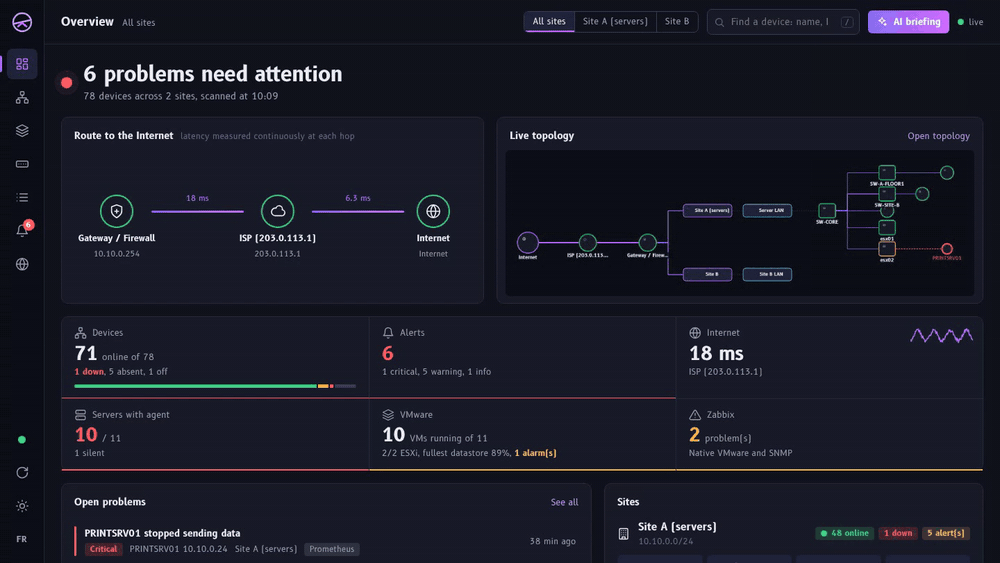
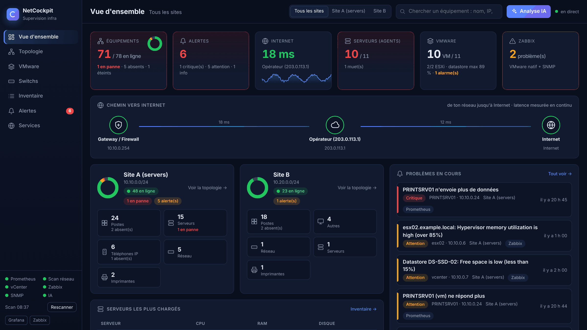
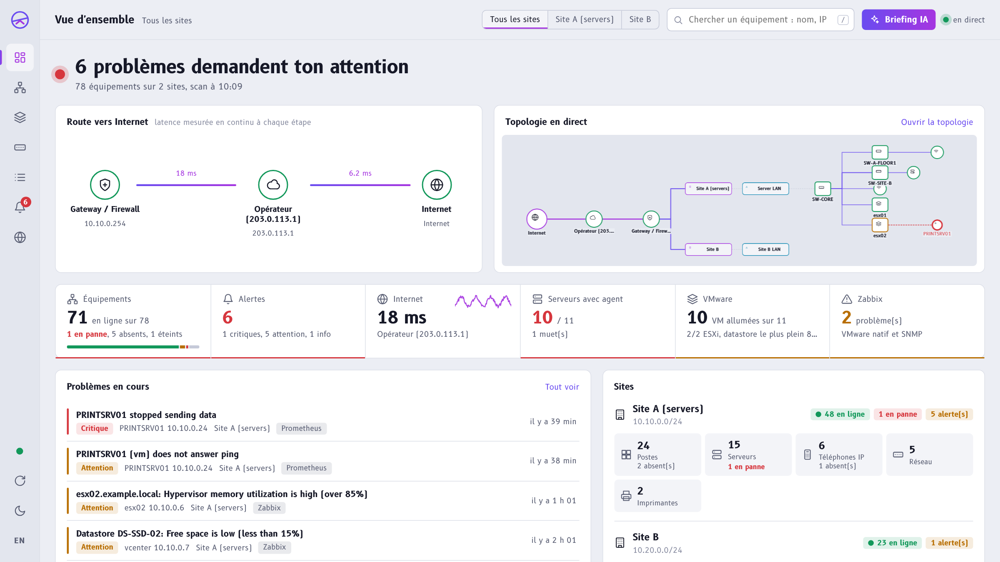
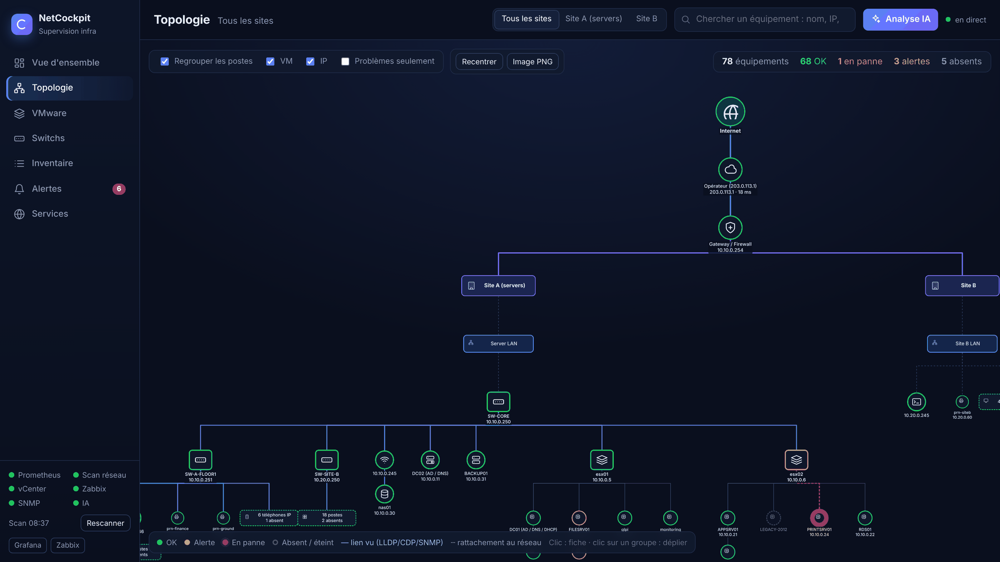
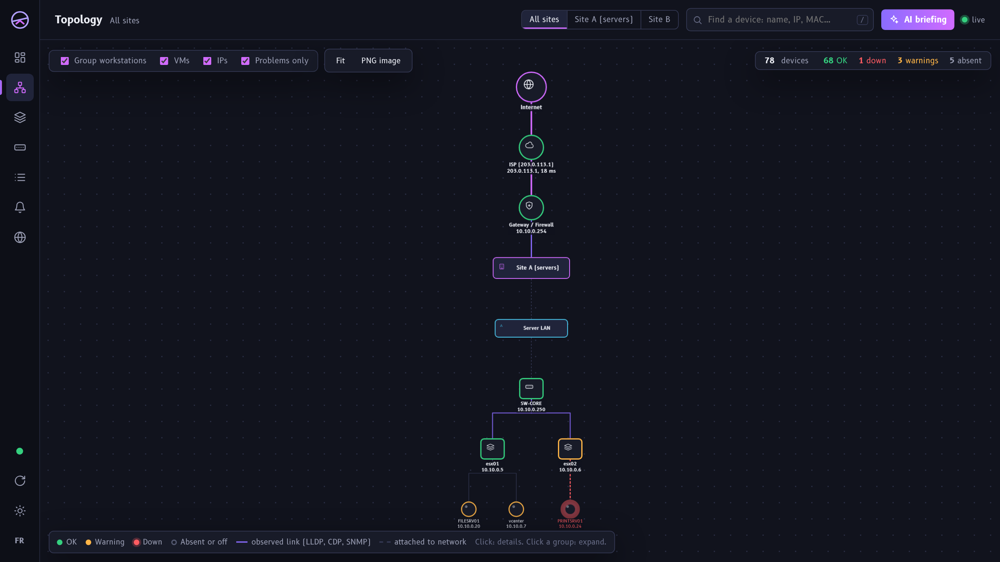
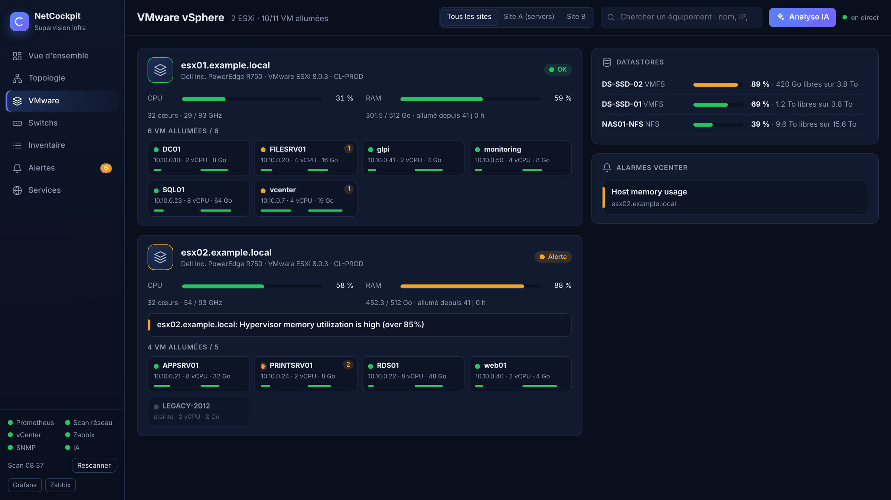
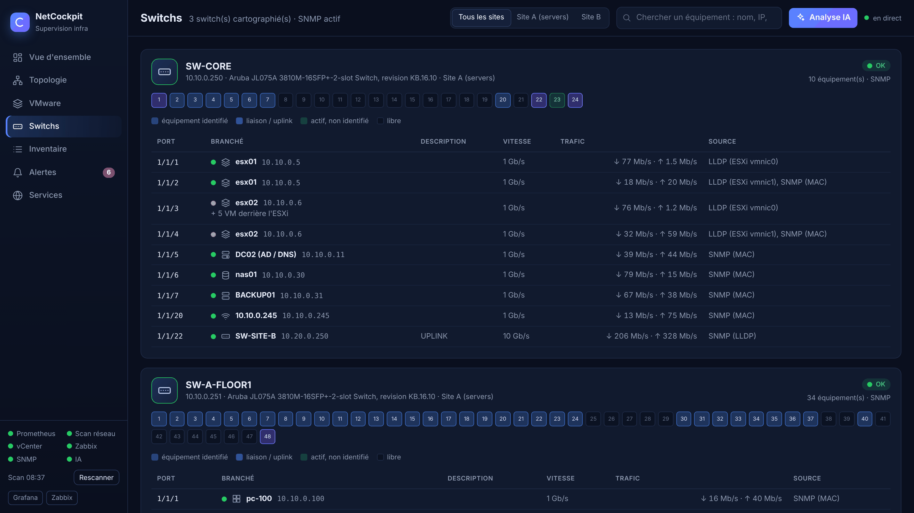
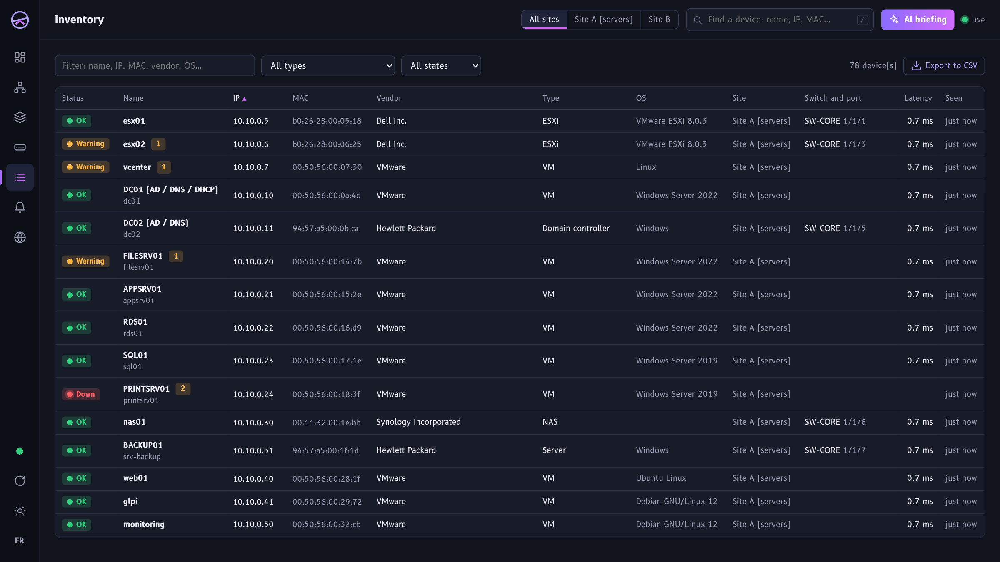
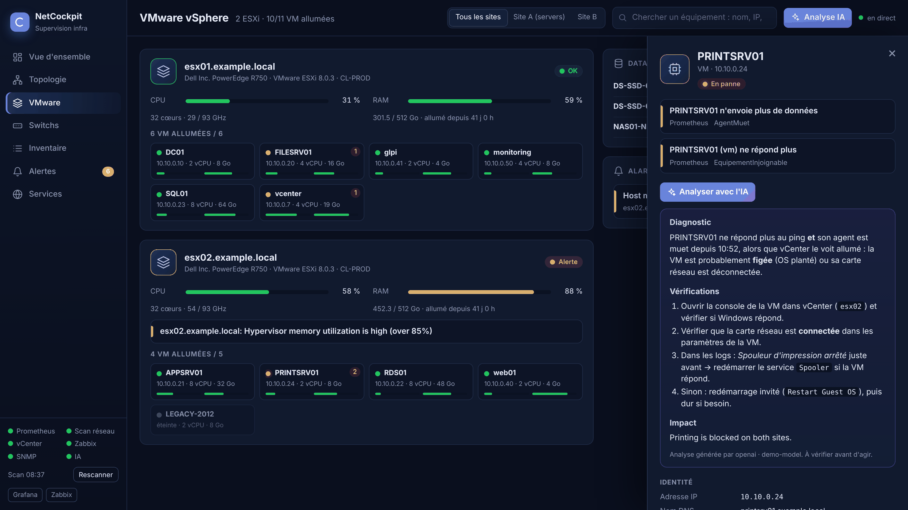
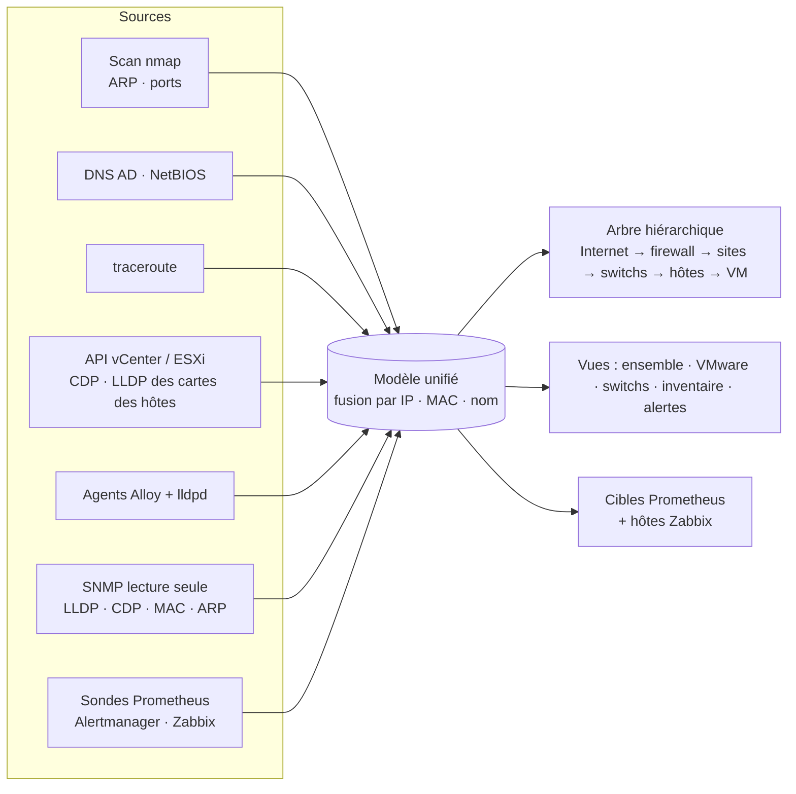

<div align="center">


# NetCockpit

### Toute ton infrastructure, en direct, dans un seul cockpit.

**Topologie découverte automatiquement, VMware, switchs port par port, alertes, logs et diagnostic IA en option,<br>pour les équipes informatiques dont les switchs et firewalls sont gérés par un prestataire.**

[](https://github.com/B2ZO0/netcockpit/actions/workflows/ci.yml)
[](https://github.com/B2ZO0/netcockpit/releases)
[](LICENSE)
[](https://github.com/B2ZO0/netcockpit/stargazers)


[English](README.md) · **Français** · [Essayer la démo](#-démo-en-une-minute) · [Installation](#-installation) · [Documentation](docs/)



<sub>Tout ce qui est affiché vient de la démo intégrée : les noms et les adresses IP sont fictifs.</sub>

</div>

---

## Pourquoi NetCockpit ?

Beaucoup d'entreprises ont externalisé leur réseau. Le prestataire gère les switchs, le firewall et les routeurs, et l'équipe informatique interne n'a **aucun accès administrateur** dessus. Les outils classiques n'affichent alors qu'une liste d'adresses IP, et le schéma réseau reste un fichier Visio que personne ne met à jour.

NetCockpit **croise toutes les sources auxquelles tu as accès** : scan réseau, DNS Active Directory, NetBIOS, traceroute, vCenter ou ESXi, agents sur les serveurs, et SNMP dès que le prestataire l'ouvre. Il en tire une **vraie carte hiérarchique de l'infrastructure, mise à jour en direct**, avec les problèmes affichés dessus, et te dit en une phrase si tout va bien.

Il ne remplace ni Prometheus, ni Grafana, ni Zabbix : il **les installe, les configure, et ajoute ce qui leur manque**, un cockpit qui comprend tes sites, ton VMware et ton réseau sans que personne n'ait rien à dessiner.

## ✨ Points forts

- 🗺️ **Une vraie topologie, automatique.** Internet → opérateur → firewall → sites → réseaux → switchs → serveurs et ESXi → VM. Rien à dessiner, mise à jour toutes les 15 secondes.
- 🔌 **Qui est branché sur quel port ?** Le CDP/LLDP est lu **via les ESXi** et les serveurs Linux, sans toucher aux switchs. Avec un accès SNMP en lecture seule, tu obtiens la carte complète, port par port.
- 🏷️ **De vrais noms, pas des IP.** DNS AD, NetBIOS (noms et MAC des PC Windows, même sur un site distant), noms vCenter et noms des agents.
- 🚦 **Pas de fausses alertes.** Un portable rentré à la maison apparaît *absent*, en gris. Le rouge est réservé aux serveurs, VM, hyperviseurs, firewalls, switchs et contrôleurs de domaine qui ne répondent plus.
- 🖥️ **VMware d'un coup d'œil.** Chaque hôte, ses VM (CPU, RAM, IP, OS), les datastores et les alarmes vCenter. Fonctionne avec un **vCenter ou un ESXi seul**, en lecture seule.
- 🔔 **Une seule chaîne d'alertes.** Prometheus, Loki et Zabbix passent tous par Alertmanager vers Telegram, Discord ou email, regroupés et dédoublonnés : si le firewall tombe, tu reçois un message, pas 80.
- 🤖 **Diagnostic IA, en option.** Un bouton « Analyser » sur chaque équipement et un briefing de la situation, avec une API d'IA dans le cloud ou un **modèle local** (Ollama : rien ne sort du réseau).
- ✈️ **Un vrai cockpit, pas un énième template d'admin.** Une phrase te dit où en est l'infra, la route vers Internet est tracée comme la ligne magenta d'un plan de vol, et l'interface utilise [B612](https://github.com/polarsys/b612), la police conçue par Airbus pour les écrans de cockpit. Thèmes nuit et jour, français et anglais.
- 📦 **Une seule commande.** `./setup.sh` génère les mots de passe et les configurations, sauvegarde tes réglages et démarre tout. Relançable à volonté.

## 📸 Captures

| Vue d'ensemble | Le même écran, thème jour, en français |
|---|---|
|  |  |
| **Topologie en direct** | **Problèmes seulement (écran mural)** |
|  |  |
| **VMware** | **Switchs, port par port** |
|  |  |
| **Inventaire (export CSV)** | **Fiche équipement + analyse IA** |
|  |  |

L'interface suit la langue du navigateur et le thème du système ; les deux se changent depuis la barre de gauche.

## ⚡ Démo en une minute

La démo simule un réseau complet sur deux sites : firewall, 2 ESXi, 11 VM, switchs, bornes Wi-Fi, imprimantes, téléphones IP, PC, et quelques pannes. **Rien n'est scanné, aucun identifiant n'est nécessaire.**

```bash
git clone https://github.com/B2ZO0/netcockpit.git && cd netcockpit
docker compose -f docker-compose.demo.yml up --build
```

Ouvre ensuite **http://localhost:8088**. Sans Docker : `pip install pyyaml requests && python demo/demo.py`.

## 🧩 Fonctionnalités

| Domaine | Ce que tu obtiens |
|---|---|
| **Découverte** | Balayage nmap ping/ARP et empreinte des ports, noms NetBIOS, DNS inverse sur ton AD, détection automatique des contrôleurs de domaine, traceroute vers Internet, détection des nouveaux appareils |
| **Topologie** | Arbre hiérarchique avec regroupement, filtre par site, mode « problèmes seulement », export PNG, état en direct toutes les 15 s, mini-carte sur la vue d'ensemble |
| **Switchs** | CDP/LLDP via les ESXi (API vCenter) et les serveurs Linux (lldpd) ; carte complète en SNMP : voisins LLDP/CDP, tables MAC, ARP, état, vitesse et trafic des ports |
| **VMware** | Hôtes, VM, datastores, alarmes, statistiques (vCenter ou ESXi seul), plus la supervision VMware native de Zabbix |
| **Serveurs** | Agent Grafana Alloy (Linux et Windows) : CPU, RAM, disques, services, systemd, journaux Windows, journald ; installation en une ligne, servie par le cockpit |
| **Disponibilité** | Blackbox exporter : ICMP, TCP, HTTP(S) avec expiration des certificats, DNS |
| **Logs** | Loki : logs des serveurs + **récepteur syslog** (UDP/TCP 514) pour les firewalls et les switchs |
| **Alertes** | ~40 règles prêtes à l'emploi (panne, disque plein ou qui se remplit, CPU/RAM, datastore, alarmes vCenter, force brute SSH, erreurs disque, OOM, port de switch saturé, certificat, nouvel appareil…), Alertmanager → Telegram / Discord / email |
| **Zabbix** | Configuré automatiquement : modèle VMware, découverte SNMP, et chaque équipement important trouvé par le cockpit est déclaré dans Zabbix, rangé par site et par type |
| **Grafana** | 7 tableaux de bord fournis : vue d'ensemble (avec graphe), serveur, réseau et inventaire, VMware, switchs (SNMP), Zabbix, logs |
| **IA (option)** | API Anthropic ou toute API compatible OpenAI (OpenAI, Mistral, Ollama, LM Studio…), réponses dans la langue de l'interface |
| **Interface** | Français et anglais, thèmes nuit et jour, recherche au clavier (`/`), fonctionne hors ligne (aucun CDN, polices incluses) |

## 🧭 Comment la topologie est construite sans accès au réseau



| Source | Apporte | Il faut |
|---|---|---|
| Scan | Tous les appareils actifs, ports ouverts, constructeur (MAC, réseau local) | Rien |
| DNS / NetBIOS | Noms des machines, MAC des PC Windows même sur un site distant | Tes serveurs DNS dans la config |
| Traceroute | Passerelle → routeur du prestataire → opérateur → Internet | Rien |
| vCenter / ESXi | Hôtes, VM, datastores, alarmes, **switch et port de chaque carte réseau des hôtes** | Un compte en lecture seule |
| Agents | Ressources, logs, switch et port des serveurs Linux physiques | Une commande par serveur |
| SNMP | Topologie complète port par port, trafic, erreurs | Une communauté en lecture seule donnée par le prestataire |

## 🚀 Installation

**Prérequis :** une VM Linux (Debian 12 / Ubuntu 24.04), **4 vCPU, 8 Go de RAM** (6 Go sans Zabbix), 60 Go de disque, Docker avec le plugin compose.

```bash
curl -fsSL https://get.docker.com | sh            # si Docker n'est pas installé
git clone https://github.com/B2ZO0/netcockpit.git && cd netcockpit
./setup.sh                                         # crée .env (mots de passe aléatoires), config/cockpit.yml, démarre tout
nano config/cockpit.yml                            # tes sites, réseaux, équipements critiques, sites web
nano .env                                          # vCenter/ESXi, notifications, IA
./setup.sh                                         # applique
```

| Service | Adresse |
|---|---|
| **Cockpit** | `http://<IP>:8088` |
| Grafana | `http://<IP>:3000` (admin / `GRAFANA_ADMIN_PASSWORD`) |
| Zabbix | `http://<IP>:8081` (Admin / `ZABBIX_ADMIN_PASSWORD`) |
| Prometheus · Alertmanager | `:9090` · `:9093` |

Ensuite, installe les agents. Le cockpit sert lui-même les scripts :

```powershell
# Windows (PowerShell administrateur, sur le serveur)
Set-ExecutionPolicy -Scope Process Bypass -Force
iwr http://<IP>:8088/agents/windows/install.ps1 -OutFile $env:TEMP\install.ps1 -UseBasicParsing
& $env:TEMP\install.ps1 -Server <IP>
```
```bash
# Linux
curl -fsSL http://<IP>:8088/agents/linux/install.sh | sudo bash -s <IP>
```

➡️ Guides détaillés (en anglais) : [installation](docs/installation.md) · [configuration](docs/configuration.md) · [agents](docs/agents.md) · [topologie](docs/topology.md) · [alertes](docs/alerts.md) · [dépannage](docs/troubleshooting.md)

### Une mise à jour ne touche jamais à tes réglages

```bash
git pull && ./setup.sh
```

Ton `.env` et ton `config/cockpit.yml` ne sont **jamais versionnés ni écrasés** (le dépôt ne contient que le modèle `config/cockpit.example.yml`), l'historique vit dans les volumes Docker, et `setup.sh` copie tes réglages dans `backups/<date>/` avant chaque lancement. Détails dans [Upgrading](docs/installation.md#upgrading-your-settings-are-never-lost).

## 📨 Ce qu'il est utile de demander au prestataire réseau

1. Un accès **SNMP v2c en lecture seule** sur les switchs, le firewall et les routeurs, depuis l'IP de la supervision : carte complète port par port, trafic et erreurs.
2. L'**envoi des logs syslog** vers la supervision, sur le port 514.
3. **LLDP ou CDP activé** sur les ports des serveurs.
4. Son **accord pour le scan interne** (ping et quelques ports toutes les 30 minutes), pour ne pas déclencher son IDS.

## ❓ Questions fréquentes

**Faut-il un accès administrateur aux switchs ou au firewall ?** Non. Tout fonctionne sans ; le SNMP en lecture seule ajoute seulement le détail port par port.

**Est-ce que des données sortent du réseau ?** Non, sauf si tu actives l'IA avec un fournisseur dans le cloud. Avec un modèle local (Ollama), rien ne sort.

**Est-ce lourd ?** La pile complète avec Zabbix est dimensionnée pour 4 vCPU et 8 Go de RAM ; sans Zabbix, 6 Go suffisent.

**Peut-on l'installer à côté d'autres conteneurs ?** Oui. Il utilise les ports 8088, 3000, 9090, 9093, 3100 et 514, plus 8081 et 10051 quand Zabbix est activé.

**Seulement VMware ?** Pour l'instant oui, plus tout serveur physique équipé d'un agent. Hyper-V et Proxmox sont prévus.

## 🔐 Sécurité

- Le remote-write de Prometheus, le push de Loki et le syslog n'ont **pas d'authentification** : garde-les sur ton réseau interne, n'expose jamais ces ports sur Internet.
- Les secrets sont dans `.env` (droits 600), les sauvegardes dans `backups/` (droits 700). vCenter/ESXi n'a besoin que d'un rôle en **lecture seule**.
- L'IA est **désactivée par défaut**. Avec un fournisseur dans le cloud, les données de l'équipement analysé (nom, IP, alertes, extraits de logs) lui sont envoyées. Utilise un modèle local si ce n'est pas acceptable.

Pour signaler une faille : [SECURITY.md](SECURITY.md).

## 🗺️ Feuille de route

- [x] Interface en français et en anglais, thèmes nuit et jour
- [x] Mises à jour sans risque : réglages jamais versionnés, sauvegardes automatiques
- [ ] D'autres langues (un bloc à ajouter dans `cockpit/static/i18n.js`)
- [ ] Plusieurs vCenter / ESXi
- [ ] SNMPv3
- [ ] Inventaire Hyper-V et Proxmox
- [ ] Authentification devant le cockpit (exemple OIDC / reverse proxy)
- [ ] Chart Helm

Idées, traductions et pull requests bienvenues : voir [CONTRIBUTING.md](CONTRIBUTING.md).

## 🙏 Remerciements

NetCockpit assemble d'excellents projets open source, détaillés dans le [README anglais](README.md#-credits) : Prometheus, Alertmanager, Blackbox et SNMP exporter, Grafana, Loki, Alloy, Zabbix, Cytoscape.js, la police B612 (Airbus, Intactile Design et ENAC, licence SIL OFL), Nmap, pyVmomi, lldpd et net-snmp.

## 📄 Licence

[MIT](LICENSE). Les composants tiers gardent leur propre licence (voir `cockpit/static/lib/LICENSES.txt`).

---

<div align="center">

### ⭐ Si NetCockpit te fait gagner du temps, une étoile aide d'autres admins à le trouver.

[](https://star-history.com/#B2ZO0/netcockpit&Date)

</div>
