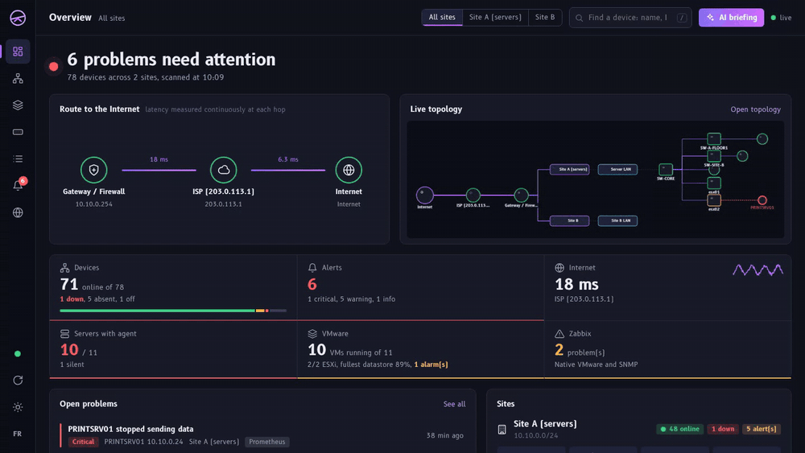
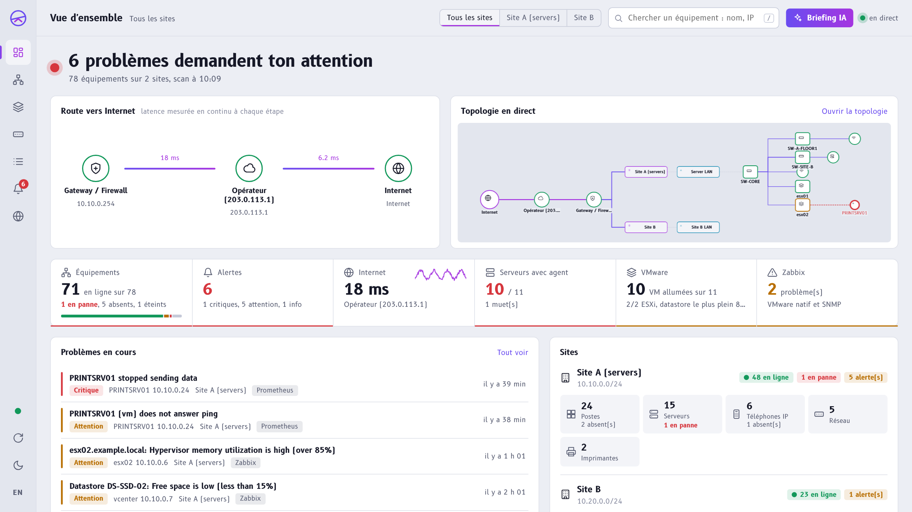
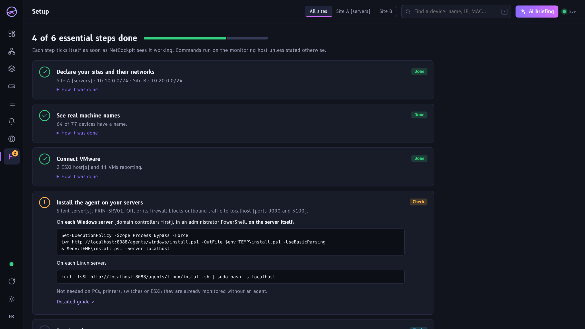
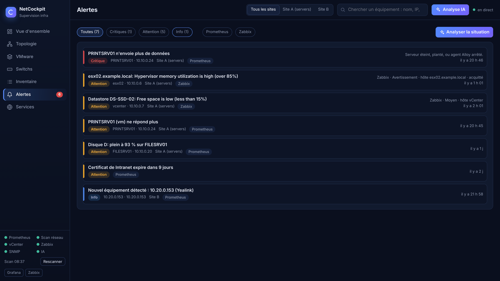
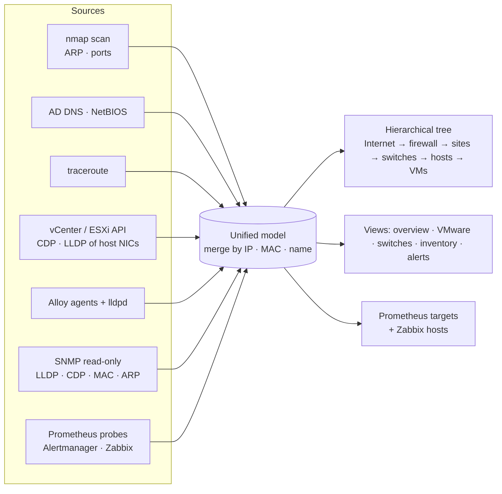
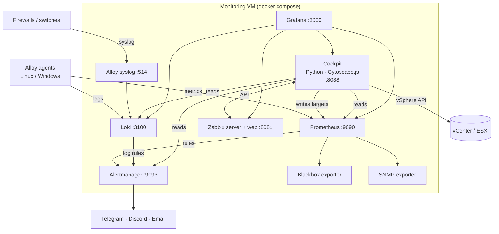

<div align="center">


# NetCockpit

### Your whole infrastructure, live, in one cockpit.

**Auto-discovered topology, VMware, switches port by port, alerts, logs and optional AI diagnosis,<br>for IT teams whose switches and firewalls are managed by someone else.**

[](https://github.com/B2ZO0/netcockpit/actions/workflows/ci.yml)
[](https://github.com/B2ZO0/netcockpit/releases)
[](LICENSE)
[](https://github.com/B2ZO0/netcockpit/stargazers)


**English** · [Français](README.fr.md) · [Try the demo](#-try-it-in-one-minute) · [Step-by-step guide](docs/getting-started.md) · [Docs](docs/)



<sub>Everything above is the built-in demo: names and IP addresses are fictitious.</sub>

</div>

---

## Why NetCockpit?

Many companies outsource their network. The provider manages the switches, the firewall and the routers, and the internal IT team has **no admin access** to them. Classic tools then show a flat list of IP addresses, and the network map stays a Visio file nobody updates.

NetCockpit **combines every source you *do* have access to**: network scan, Active Directory DNS, NetBIOS, traceroute, vCenter or ESXi, server agents, and SNMP as soon as your provider opens it. It builds a **real, live, hierarchical map** of your infrastructure, with the problems drawn on it, and tells you in one sentence whether everything is fine.

It does not replace Prometheus, Grafana or Zabbix: it **ships them, configures them, and adds the piece they lack**, a cockpit that understands your sites, your VMware and your network without anyone drawing anything.

## ✨ Highlights

- 🗺️ **Real topology, automatically.** Internet → ISP → firewall → sites → networks → switches → servers and ESXi → VMs. No manual drawing, updated every 15 seconds.
- 🔌 **Which port is everything plugged into?** CDP/LLDP is read **through your ESXi hosts** and Linux servers, without touching the switches. Add read-only SNMP and you get the full port-by-port map.
- 🏷️ **Real names, not IPs.** AD DNS, NetBIOS (Windows names and MACs even across routers), vCenter and agent names.
- 🚦 **No false alarms.** A laptop that went home is *absent* (grey), not *down*. Red is reserved for servers, VMs, hypervisors, firewalls, switches and domain controllers that stopped answering.
- 🖥️ **VMware at a glance.** Every host, its VMs (CPU, RAM, IPs, OS), datastores and vCenter alarms. Works with **vCenter or a standalone ESXi**, read-only.
- 🔔 **One alert pipeline.** Prometheus, Loki and Zabbix all go through Alertmanager to Telegram, Discord or email, grouped and de-duplicated: if the firewall dies, you get one message, not 80.
- 🤖 **AI diagnosis, optional.** "Explain this problem" on any device and a situation briefing, with a cloud LLM API or a **local model** (Ollama: nothing leaves your network).
- ✈️ **A real cockpit, not another admin template.** One sentence tells you how things are, the route to the Internet is drawn like the magenta line of a flight plan, and the UI uses [B612](https://github.com/polarsys/b612), the typeface Airbus designed for cockpit screens. Night and day themes, English and French.
- 📦 **One command, no YAML to write.** `./setup.sh` detects your network, asks a few questions with sensible defaults, backs up your settings and starts everything. Re-run it any time.

## 📸 Screenshots

| Overview | Same screen, day theme, in French |
|---|---|
|  |  |
| **Live topology** | **Problems only (wall screen)** |
|  |  |
| **VMware** | **Switches, port by port** |
|  |  |
| **Inventory (CSV export)** | **Device sheet + AI analysis** |
|  |  |
| **Setup checklist (ticks itself)** | **Alerts from every source** |
|  |  |

The interface follows your browser language and your system theme; switch both from the left rail.

## ⚡ Try it in one minute

The demo simulates a complete two-site network: firewall, 2 ESXi hosts, 11 VMs, switches, Wi-Fi access points, printers, IP phones, PCs and a few failures. **Nothing is scanned, no credentials needed.**

```bash
git clone https://github.com/B2ZO0/netcockpit.git && cd netcockpit
docker compose -f docker-compose.demo.yml up --build
```

Open **http://localhost:8088**. Without Docker: `pip install pyyaml requests && python demo/demo.py`.

## 🧩 Features

| Area | What you get |
|---|---|
| **Discovery** | nmap ping/ARP sweep and port fingerprinting, NetBIOS names, reverse DNS against your AD, domain controller auto-detection, traceroute to the Internet, new-device detection |
| **Topology** | Hierarchical tree with grouping, per-site filter, "problems only" mode, PNG export, live status every 15 s, mini map on the overview |
| **Switches** | CDP/LLDP from ESXi (vCenter API) and Linux servers (lldpd); full map from SNMP: LLDP/CDP neighbours, MAC tables, ARP, port status, speed, traffic |
| **VMware** | Hosts, VMs, datastores, alarms, quick stats (vCenter or standalone ESXi), plus Zabbix native VMware monitoring |
| **Servers** | Grafana Alloy agent (Linux & Windows): CPU, RAM, disks, services, systemd, Windows Event Log, journald; one-line install served by the cockpit |
| **Availability** | Blackbox exporter: ICMP, TCP, HTTP(S) with certificate expiry, DNS |
| **Logs** | Loki: server logs + **syslog receiver** (UDP/TCP 514) for firewalls and switches |
| **Alerting** | ~40 ready-made rules (down, disk full or filling up, CPU/RAM, datastore, vCenter alarms, SSH brute force, disk I/O errors, OOM, saturated switch port, certificate, new device…), Alertmanager → Telegram / Discord / email |
| **Zabbix** | Auto-configured: VMware template, SNMP discovery, and every important device found by the cockpit is declared in Zabbix, grouped by site and type |
| **Grafana** | 7 provisioned dashboards: overview (with node graph), server, network & inventory, VMware, switches (SNMP), Zabbix, logs |
| **AI (optional)** | Anthropic API or any OpenAI-compatible endpoint (OpenAI, Mistral, Ollama, LM Studio…), answers in the interface language |
| **Setup screen** | A checklist that ticks itself (buildings, names, VMware, agents, notifications, Zabbix, SNMP), with what to do and commands ready to copy |
| **Interface** | English and French, night and day themes, keyboard search (`/`), works offline (no CDN, fonts bundled) |

## 🧭 How the topology is built without network access



| Source | Brings | Needs |
|---|---|---|
| Scan | Every live device, open ports, vendor (MAC, local subnet) | Nothing |
| DNS / NetBIOS | Machine names, Windows MACs even on remote sites | Your DNS servers in the config |
| Traceroute | Gateway → provider router → ISP → Internet | Nothing |
| vCenter / ESXi | Hosts, VMs, datastores, alarms, **switch and port of each host NIC** | A read-only account |
| Agents | Resources, logs, switch and port of physical Linux servers | One command per server |
| SNMP | Complete port-by-port topology, traffic, errors | Read-only community from your provider |

## 🚀 Installation

**Requirements:** a Linux VM (Debian 12 / Ubuntu 24.04), **4 vCPU, 8 GB RAM** (6 GB without Zabbix), 60 GB disk, Docker with the compose plugin.

```bash
curl -fsSL https://get.docker.com | sh            # if Docker is not installed
git clone https://github.com/B2ZO0/netcockpit.git && cd netcockpit
./setup.sh                                         # detects your network, asks a few questions, starts everything
```

The setup assistant detects the local network, gateway and DNS servers, then asks for your buildings (or sites), your other networks, VMware, SNMP and Telegram. Every question has a default: press Enter. Re-run it any time with `./setup.sh --configure`.

👉 **First time? Follow the [step-by-step guide](docs/getting-started.md)**: install, buildings, VMware read-only account, Zabbix, agents, Telegram, switches (including Ubiquiti UniFi), troubleshooting. Different situation (multi-site, no AD, no VMware, provider-managed network, homelab)? See the **[scenarios](docs/scenarios.md)**. Once running, the cockpit's **Setup** screen tracks what is left to do, with commands ready to copy.

| Service | URL |
|---|---|
| **Cockpit** | `http://<host>:8088` |
| Grafana | `http://<host>:3000` (admin / `GRAFANA_ADMIN_PASSWORD`) |
| Zabbix | `http://<host>:8081` (Admin / `ZABBIX_ADMIN_PASSWORD`) |
| Prometheus · Alertmanager | `:9090` · `:9093` |

Then install the agents (the cockpit serves the scripts):

```powershell
# Windows (admin PowerShell, on the server)
Set-ExecutionPolicy -Scope Process Bypass -Force
iwr http://<host>:8088/agents/windows/install.ps1 -OutFile $env:TEMP\install.ps1 -UseBasicParsing
& $env:TEMP\install.ps1 -Server <host>
```
```bash
# Linux
curl -fsSL http://<host>:8088/agents/linux/install.sh | sudo bash -s <host>
```

➡️ Full guides: [Installation](docs/installation.md) · [Configuration](docs/configuration.md) · [Agents](docs/agents.md) · [Topology & data sources](docs/topology.md) · [Alerts](docs/alerts.md) · [Troubleshooting](docs/troubleshooting.md)

### Upgrading never touches your settings

```bash
git pull && ./setup.sh
```

Your `.env` and `config/cockpit.yml` are **never versioned and never overwritten** (the repository only ships `config/cockpit.example.yml`), history lives in Docker volumes, and `setup.sh` copies your settings to `backups/<date>/` before every run. Details in [Upgrading](docs/installation.md#upgrading-your-settings-are-never-lost).

## 📨 What to ask your network provider

1. **Read-only SNMP v2c** on switches, firewall and routers, from the monitoring host's IP: full port-by-port map, traffic and errors.
2. **Syslog forwarding** to the monitoring host, port 514.
3. **LLDP or CDP enabled** on server-facing ports.
4. Their **agreement for the internal scan** (ping and a few ports every 30 minutes), so it does not trigger their IDS.

## ❓ FAQ

**Do I need admin access to my switches or firewall?** No. Everything works without it; read-only SNMP only adds the port-by-port detail.

**Does anything leave my network?** No, unless you enable the AI feature with a cloud provider. With a local model (Ollama), nothing leaves.

**Is it heavy?** The full stack with Zabbix is sized for 4 vCPU and 8 GB RAM; without Zabbix, 6 GB is enough.

**Can I run it next to other containers?** Yes. It uses ports 8088, 3000, 9090, 9093, 3100 and 514, plus 8081 and 10051 when Zabbix is enabled.

**Only VMware?** For now, yes, plus any physical server with an agent. Hyper-V and Proxmox are on the roadmap.

## 🏗️ Architecture



## 🔐 Security notes

- Prometheus remote-write, Loki push and syslog have **no authentication**: keep them on your internal network, never expose these ports to the Internet.
- Secrets live in `.env` (mode 600), backups in `backups/` (mode 700). vCenter/ESXi only needs a **read-only** role.
- The AI feature is **off by default**. When enabled with a cloud provider, the data of the analysed device (name, IP, alerts, log excerpts) is sent to that provider. Use a local model if that is not acceptable.

See [SECURITY.md](SECURITY.md) to report a vulnerability.

## 🗺️ Roadmap

- [x] English and French UI, night and day themes
- [x] Safe upgrades: settings never versioned, automatic backups
- [ ] More languages (one block to add in `cockpit/static/i18n.js`)
- [ ] Several vCenter / ESXi endpoints
- [ ] SNMPv3
- [ ] Hyper-V and Proxmox inventory
- [ ] Authentication in front of the cockpit (OIDC / reverse proxy example)
- [ ] Helm chart

Ideas, translations and pull requests are welcome: see [CONTRIBUTING.md](CONTRIBUTING.md).

## 🙏 Credits

NetCockpit is glue and UI on top of excellent open-source projects:

- [Prometheus](https://prometheus.io), [Alertmanager](https://github.com/prometheus/alertmanager), [Blackbox exporter](https://github.com/prometheus/blackbox_exporter), [SNMP exporter](https://github.com/prometheus/snmp_exporter)
- [Grafana](https://grafana.com), [Loki](https://grafana.com/oss/loki/), [Grafana Alloy](https://grafana.com/oss/alloy/)
- [Grafana Zabbix plugin](https://github.com/grafana/grafana-zabbix) and [Infinity datasource](https://github.com/grafana/grafana-infinity-datasource)
- [Zabbix](https://www.zabbix.com)
- [Cytoscape.js](https://js.cytoscape.org) and [cytoscape-fcose](https://github.com/iVis-at-Bilkent/cytoscape.js-fcose) (iVis@Bilkent), bundled under the MIT licence in `cockpit/static/lib/`
- [B612](https://github.com/polarsys/b612) typeface by Airbus, Intactile Design and ENAC, bundled under the SIL Open Font License in `cockpit/static/lib/fonts/`
- [Nmap](https://nmap.org), [pyVmomi](https://github.com/vmware/pyvmomi), [lldpd](https://lldpd.github.io), [net-snmp](http://www.net-snmp.org)

## 📄 License

[MIT](LICENSE). Third-party components keep their own licences (see `cockpit/static/lib/LICENSES.txt`).

---

<div align="center">

Made by [Enzo Marechal](https://enzomarechal.fr) ([@B2ZO0](https://github.com/B2ZO0)), junior system and network administrator.

### ⭐ If NetCockpit saves you time, a star helps other admins find it.

[](https://star-history.com/#B2ZO0/netcockpit&Date)

</div>
