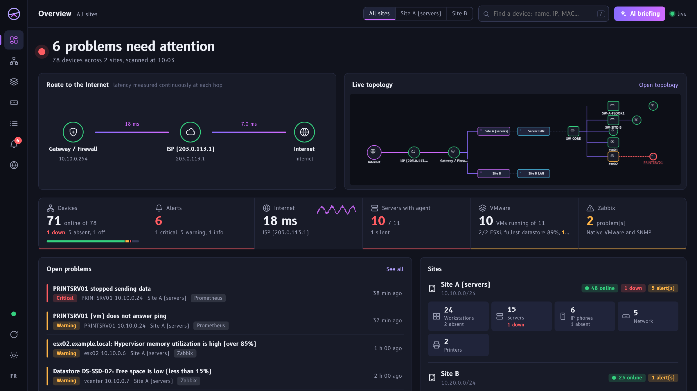
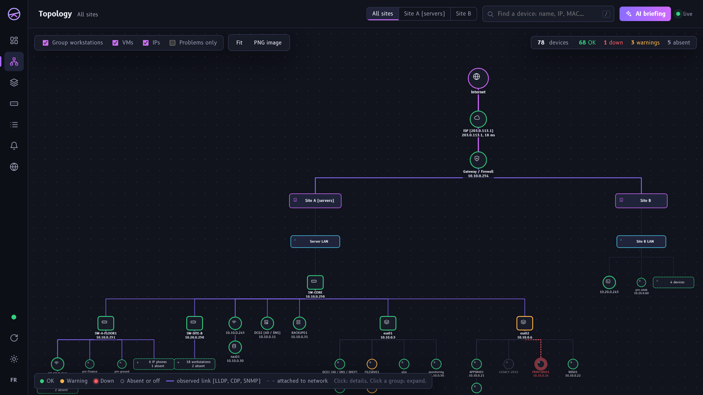
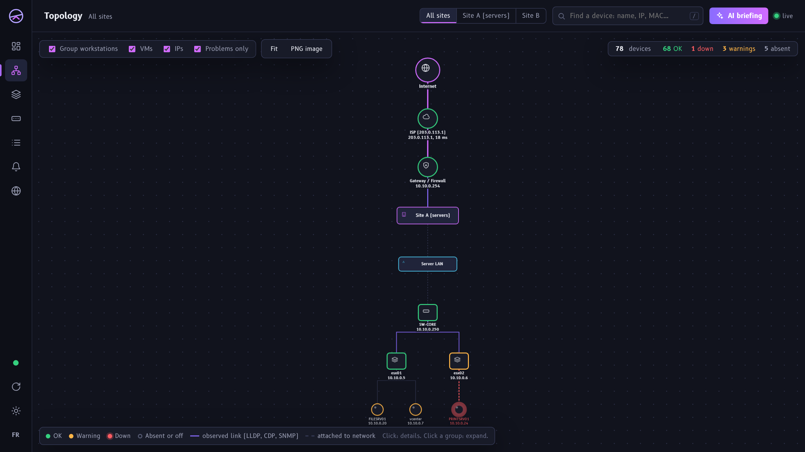
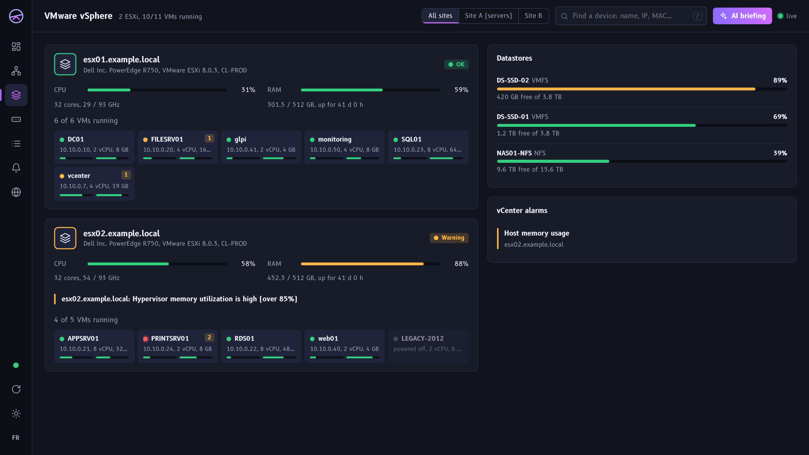
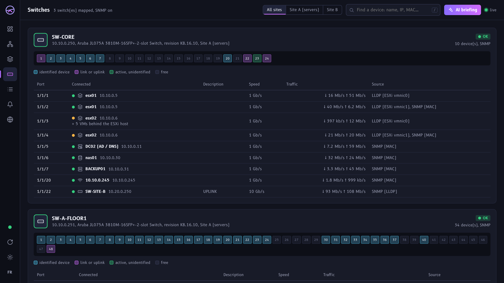
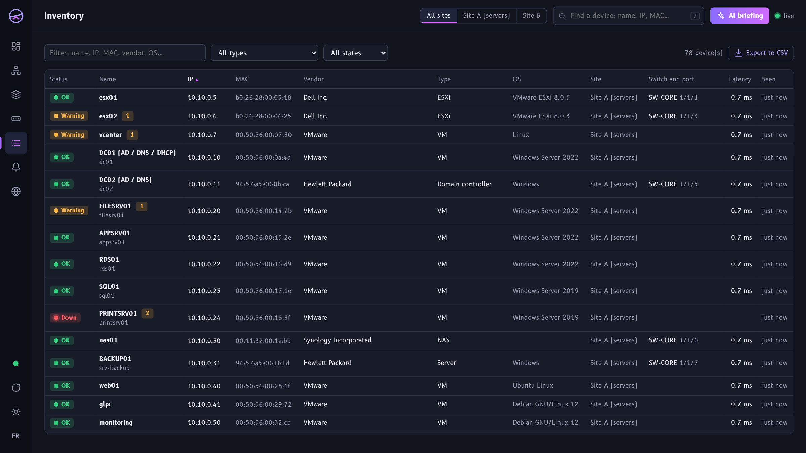
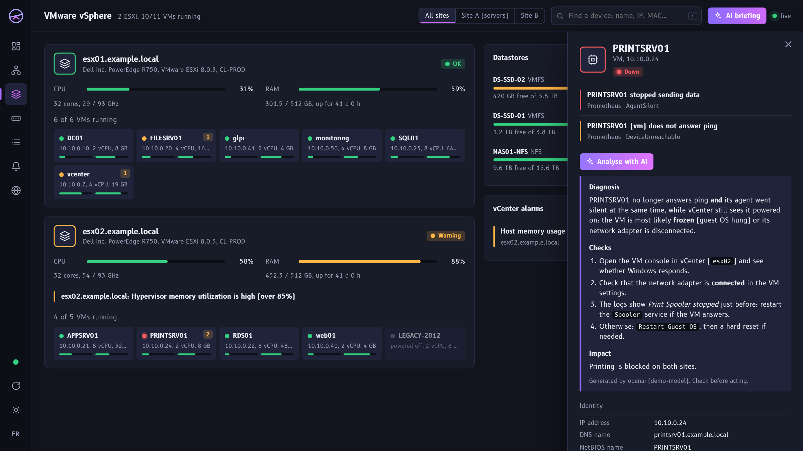
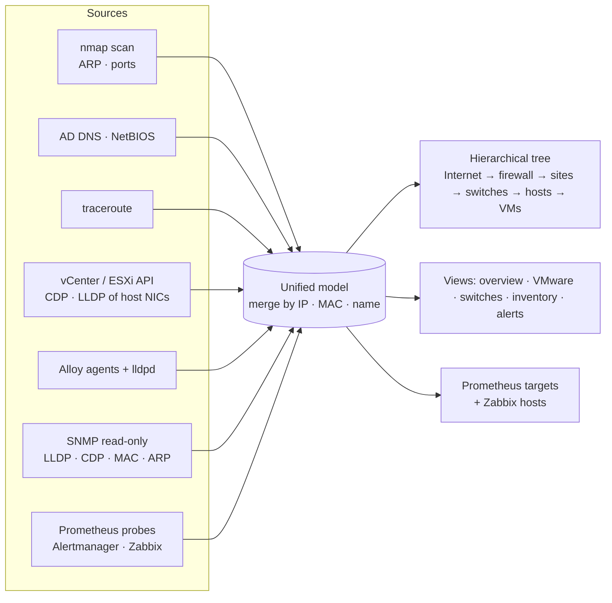
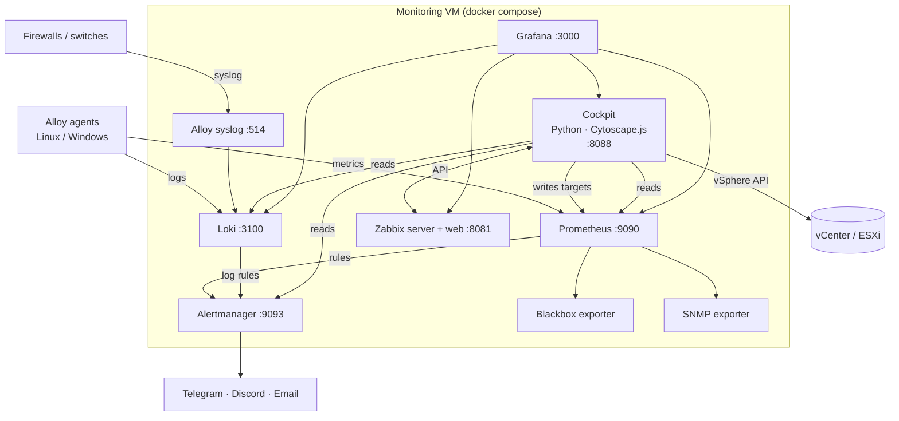

<div align="center">


# NetCockpit

**A live infrastructure cockpit for small and mid-size IT teams — even when the switches and firewalls are managed by someone else.**

Auto-discovered topology · VMware · switches port by port · alerts · logs · optional AI diagnosis
Built on Prometheus, Loki, Alertmanager, Grafana and Zabbix. One command to install.


[Français](README.fr.md) · [Demo in 1 minute](#-try-it-in-1-minute-demo) · [Install](#-installation) · [Docs](docs/)



</div>

---

## Why NetCockpit?

Many companies outsource their network: the provider manages the switches, the firewall and the routers, and the internal IT team has **no admin access** to them. Classic tools then show you a flat list of IP addresses and little else.

NetCockpit takes another approach: it **combines every source you do have access to** (network scan, Active Directory DNS, NetBIOS, traceroute, vCenter/ESXi, server agents, SNMP when it becomes available) and builds a **real, live, hierarchical map** of your infrastructure, with the problems on it.

- 🗺️ **Real topology, automatically**: Internet → ISP → firewall → sites → networks → switches → servers and ESXi → VMs. No manual drawing.
- 🔌 **Which port is everything plugged into?** It reads CDP/LLDP **through your ESXi hosts** and Linux servers, without touching the switches. With read-only SNMP, you get the full port-by-port map.
- 🏷️ **Real names, not IPs**: AD DNS, NetBIOS (Windows names and MACs even across routers), vCenter and agent names.
- 🚨 **No false alarms**: a laptop that left for the evening is shown as *absent* (grey), not *down*. Red is for servers, VMs, hypervisors, firewalls, switches and DCs that stopped answering.
- 🖥️ **VMware view**: every host, its VMs (CPU, RAM, IPs, OS), datastores and vCenter alarms. Works with **vCenter or a standalone ESXi**.
- 🔔 **One alert pipeline**: Prometheus, Loki (logs) and Zabbix problems all go through Alertmanager → Telegram, Discord or email, with grouping and inhibition (if the firewall dies, you don't get 80 "device unreachable" messages).
- 🤖 **Optional AI diagnosis**: "Explain this problem" on any device and a situation summary, with Claude or a **local model** (Ollama, nothing leaves your network).
- ✈️ **A real cockpit, not another admin template**: one sentence tells you how things are, the route to the Internet is drawn like the magenta line of a flight plan, and the whole UI uses [B612](https://github.com/polarsys/b612), the typeface Airbus designed for cockpit screens. Night and day themes, English and French.
- 📦 **One command**: `./setup.sh` generates passwords and configs and starts everything. Re-run it any time; it never breaks your settings.

## 📸 Screenshots

| Live topology | Problems only (wall screen) |
|---|---|
|  |  |
| **VMware** | **Switches, port by port** |
|  |  |
| **Inventory (CSV export)** | **Device sheet + AI analysis** |
|  |  |

> All screenshots come from the built-in demo: every name and IP address is fictitious.
> The interface follows your browser language (English or French) and your system theme; switch both from the left rail.

## ⚡ Try it in 1 minute (demo)

The demo simulates a complete two-site network (firewall, 2 ESXi, 11 VMs, switches, Wi-Fi access points, printers, IP phones, PCs, some failures). **Nothing is scanned, no credentials needed.**

```bash
git clone https://github.com/B2ZO0/netcockpit.git && cd netcockpit
docker compose -f docker-compose.demo.yml up --build
```

Open **http://localhost:8088**. Without Docker: `pip install pyyaml requests && python demo/demo.py`.

## ✨ Features

| Area | What you get |
|---|---|
| **Discovery** | nmap ping/ARP sweep and port fingerprinting, NetBIOS names, reverse DNS against your AD, domain controller auto-detection, traceroute to the Internet, new-device detection |
| **Topology** | Hierarchical tree with grouping, per-site filter, "problems only" mode, PNG export, live status every 15 s |
| **Switches** | CDP/LLDP from ESXi (vCenter API) and Linux servers (lldpd); full map from SNMP: LLDP/CDP neighbours, MAC tables, ARP, port status, speed, traffic |
| **VMware** | Hosts, VMs, datastores, alarms, quick stats (vCenter or standalone ESXi), plus Zabbix native VMware monitoring |
| **Servers** | Grafana Alloy agent (Linux & Windows): CPU, RAM, disks, services, systemd, Windows Event Log, journald; one-line install served by the cockpit |
| **Availability** | Blackbox exporter: ICMP, TCP, HTTP(S) with certificate expiry, DNS |
| **Logs** | Loki: server logs + **syslog receiver** (UDP/TCP 514) for firewalls and switches |
| **Alerting** | ~40 ready-made rules (down, disk full or filling up, CPU/RAM, datastore, vCenter alarms, SSH brute force, disk I/O errors, OOM, saturated switch port, certificate, new device…), Alertmanager → Telegram / Discord / email |
| **Zabbix** | Auto-configured: VMware template, SNMP discovery, and every important device found by the cockpit is declared in Zabbix, grouped by site and type |
| **Grafana** | 7 provisioned dashboards: overview (with node graph), server, network & inventory, VMware, switches (SNMP), Zabbix, logs |
| **AI (optional)** | Claude API or any OpenAI-compatible endpoint (Ollama, LM Studio…) |

## 🧭 How the topology is built without network access



| Source | Brings | Needs |
|---|---|---|
| Scan | Every live device, open ports, vendor (MAC, local subnet) | Nothing |
| DNS / NetBIOS | Machine names, Windows MACs even on remote sites | Your DNS servers in the config |
| Traceroute | Gateway → provider router → ISP → Internet | Nothing |
| vCenter / ESXi | Hosts, VMs, datastores, alarms, **switch and port of each host NIC** | A read-only account |
| Agents | Resources, logs, switch and port of physical Linux servers | One command per server |
| SNMP | Complete port-by-port topology, traffic, errors | Read-only community from your provider |

## 🚀 Installation

**Requirements:** a Linux VM (Debian 12 / Ubuntu 24.04), **4 vCPU, 8 GB RAM** (6 GB without Zabbix), 60 GB disk, Docker with the compose plugin.

```bash
curl -fsSL https://get.docker.com | sh            # if Docker is not installed
git clone https://github.com/B2ZO0/netcockpit.git && cd netcockpit
./setup.sh                                         # creates .env (random passwords) and starts everything
nano config/cockpit.yml                             # your sites, networks, critical equipment, websites
nano .env                                          # vCenter/ESXi, notifications, AI
./setup.sh                                         # apply
```

| Service | URL |
|---|---|
| **Cockpit** | `http://<host>:8088` |
| Grafana | `http://<host>:3000` (admin / `GRAFANA_ADMIN_PASSWORD`) |
| Zabbix | `http://<host>:8081` (Admin / `ZABBIX_ADMIN_PASSWORD`) |
| Prometheus · Alertmanager | `:9090` · `:9093` |

Then install the agents (the cockpit serves the scripts):

```powershell
# Windows (admin PowerShell, on the server)
Set-ExecutionPolicy -Scope Process Bypass -Force
iwr http://<host>:8088/agents/windows/install.ps1 -OutFile $env:TEMP\install.ps1 -UseBasicParsing
& $env:TEMP\install.ps1 -Server <host>
```
```bash
# Linux
curl -fsSL http://<host>:8088/agents/linux/install.sh | sudo bash -s <host>
```

➡️ Full guides: [Installation](docs/installation.md) · [Configuration](docs/configuration.md) · [Agents](docs/agents.md) · [Topology & data sources](docs/topology.md) · [Alerts](docs/alerts.md) · [Troubleshooting](docs/troubleshooting.md)

## 🏗️ Architecture



## 🔐 Security notes

- Prometheus remote-write, Loki push and syslog have **no authentication**: keep them on your internal network, never expose these ports to the Internet.
- Secrets live in `.env` (mode 600). vCenter/ESXi only needs a **read-only** role.
- The AI feature is **off by default**. When enabled with a cloud provider, the data of the analysed device (name, IP, alerts, log excerpts) is sent to that provider. Use a local model if that is not acceptable.
- Ask your network provider before enabling the internal scan (ping + a few ports every 30 min) so that it does not trigger their IDS.

See [SECURITY.md](SECURITY.md) to report a vulnerability.

## 🗺️ Roadmap

- [x] English and French UI, night and day themes
- [ ] More languages (one block to add in `cockpit/static/i18n.js`)
- [ ] Several vCenter / ESXi endpoints
- [ ] SNMPv3
- [ ] Hyper-V and Proxmox inventory
- [ ] Authentication in front of the cockpit (OIDC / reverse proxy example)
- [ ] Helm chart

Ideas and pull requests are welcome!

## 🙏 Credits

NetCockpit is glue and UI on top of excellent open-source projects:

- [Prometheus](https://prometheus.io), [Alertmanager](https://github.com/prometheus/alertmanager), [Blackbox exporter](https://github.com/prometheus/blackbox_exporter), [SNMP exporter](https://github.com/prometheus/snmp_exporter)
- [Grafana](https://grafana.com), [Loki](https://grafana.com/oss/loki/), [Grafana Alloy](https://grafana.com/oss/alloy/)
- [Grafana Zabbix plugin](https://github.com/grafana/grafana-zabbix) and [Infinity datasource](https://github.com/grafana/grafana-infinity-datasource)
- [Zabbix](https://www.zabbix.com)
- [Cytoscape.js](https://js.cytoscape.org) and [cytoscape-fcose](https://github.com/iVis-at-Bilkent/cytoscape.js-fcose) (iVis@Bilkent), bundled under the MIT licence in `cockpit/static/lib/`
- [B612](https://github.com/polarsys/b612) typeface by Airbus, Intactile Design and ENAC, bundled under the SIL Open Font License in `cockpit/static/lib/fonts/`
- [Nmap](https://nmap.org), [pyVmomi](https://github.com/vmware/pyvmomi), [lldpd](https://lldpd.github.io), [net-snmp](http://www.net-snmp.org)

## 📄 License

[MIT](LICENSE). Third-party components keep their own licences (see `cockpit/static/lib/LICENSES.txt`).

<div align="center">

If NetCockpit saves you time, a ⭐ helps other admins find it.

</div>
