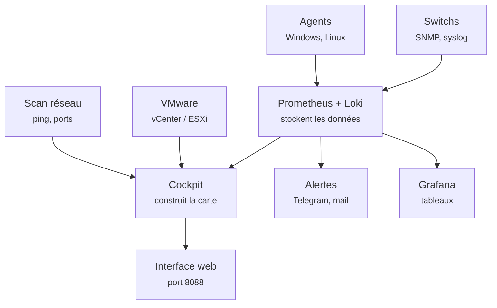
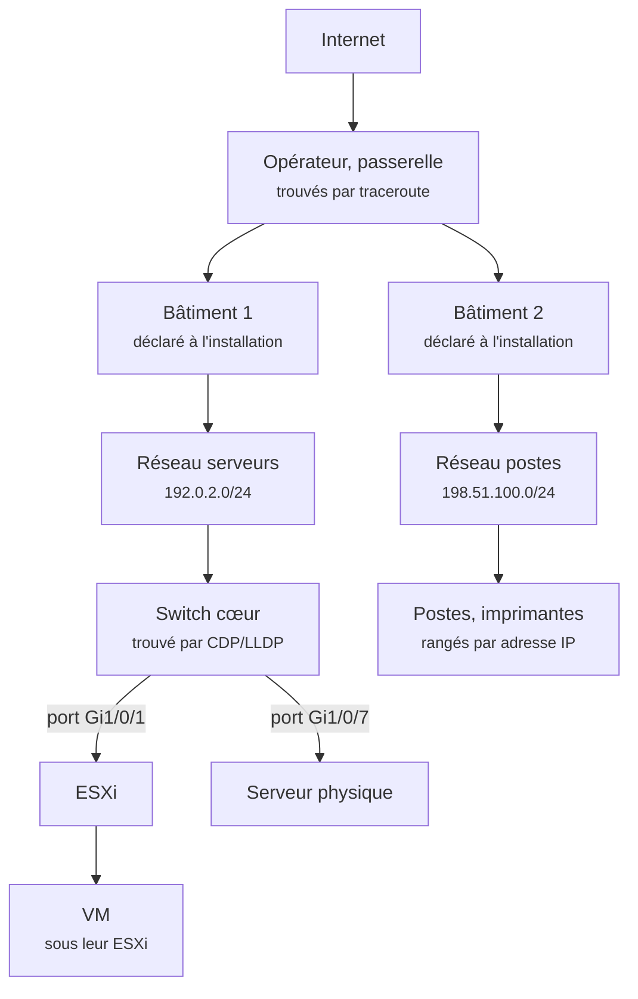

# Comment fonctionne NetCockpit

[English](how-it-works.md) · [Retour à la documentation](README.md)

Une explication simple, pour comprendre ce qui se passe entre l'installation et la carte qui s'affiche. Pour les détails techniques, voir [Topology](topology.md).

## La vue d'ensemble

Quatre idées suffisent pour tout comprendre :

1. **Les données arrivent de deux façons.** Le cockpit va **chercher** certaines informations lui-même : il scanne le réseau (qui est allumé, et qu'est-ce que c'est) et il interroge VMware. Les autres lui sont **envoyées** : les agents installés sur les serveurs Windows et Linux poussent leurs métriques et leurs journaux, et les switchs envoient leurs logs en syslog.
2. **Prometheus et Loki, c'est la mémoire.** Prometheus garde les chiffres dans le temps (CPU, RAM, disque, trafic), Loki garde les journaux. NetCockpit ne réinvente pas ces briques : il réutilise des outils connus et fiables.
3. **Le cockpit, c'est le cerveau.** C'est la partie écrite pour le projet, en Python. Il croise toutes les sources : l'adresse IP trouvée par le scan, la VM vue dans VMware, les métriques de l'agent. Il en fait une seule fiche par équipement, puis range tout par bâtiment et par réseau pour dessiner la carte.
4. **Trois sorties.** L'interface web pour voir, les alertes sur Telegram ou par mail pour être prévenu, et Grafana pour les tableaux détaillés.

## Comment la carte est construite

La carte est un arbre généalogique : chaque équipement a un « parent ». Le serveur est branché sur un switch, le switch est dans un réseau, le réseau dans un bâtiment, et ainsi de suite jusqu'à Internet.

Pour le remplir, le cockpit suit toujours le même ordre, toutes les deux minutes environ :

1. **Qui est là ? Le scan.** Il pingue chaque adresse des réseaux déclarés. Pour chaque machine qui répond, il regarde quelques ports ouverts, son nom DNS, son nom Windows (NetBIOS) et la marque de sa carte réseau. Avec ces indices, il devine son rôle :
   - 53 + 88 + 389 ouverts ensemble (DNS, Kerberos, LDAP) : un contrôleur de domaine ;
   - 902 + 443 : un ESXi ;
   - 9100 sans 22 ni 3389 : une imprimante ;
   - 3389 (bureau à distance) : un Windows ;
   - 22 seul : un Linux.
2. **Les autres sources complètent la fiche.** VMware donne les ESXi et leurs VM (chaque VM est rangée sous son ESXi), les agents donnent le vrai nom, le système, la RAM et le CPU. Un même serveur vu par le scan, par VMware et par son agent ne fait **qu'une seule** fiche : le cockpit les rapproche par l'adresse IP, l'adresse MAC ou le nom.
3. **Le chemin vers Internet.** Un traceroute donne la passerelle puis l'opérateur : c'est le haut de l'arbre.
4. **Les bâtiments et les réseaux** ne sont pas devinés : ce sont ceux déclarés à l'installation. Un réseau trouvé mais pas déclaré apparaît dans « réseaux vus mais pas encore déclarés ».
5. **Les switchs.** Pour savoir qui est branché sur quel port, le cockpit utilise **CDP et LLDP**, les petits messages que les équipements envoient à leurs voisins directs : « je suis le switch X, et tu es sur mon port Gi1/0/1 ». Il les récupère :
   - **par les ESXi**, qui reçoivent ces messages : VMware les transmet, sans aucun accès aux switchs. Ça marche même quand c'est un prestataire qui gère le réseau ;
   - **par les agents Linux** (lldpd) ;
   - **par SNMP**, quand on a un accès en lecture : tables d'adresses MAC et de voisins.

   Le switch qui a le plus de liens devient le « cœur », et les autres s'y accrochent par le bon port.
6. **Tout le reste** est rangé sous son réseau, d'après son adresse IP : la plupart des postes et des imprimantes.

## Les couleurs, sans fausses alertes

L'arbre ne bouge pas à chaque scan. Par-dessus, le cockpit colore chaque équipement :

| Couleur | Signification |
|---|---|
| Vert | Il répond (ping, port, agent ou VMware) |
| Orange / rouge | Il répond mais a des alertes |
| Rouge « tombé » | Un équipement **important** (serveur, VM, ESXi, contrôleur de domaine, switch, pare-feu) qui répondait et ne répond plus |
| Gris « absent » | Un équipement **non critique** (PC, téléphone…) qui ne répond plus : normal le soir |

Seuls les équipements importants peuvent passer en rouge et déclencher une alerte. C'est ce qui évite d'être réveillé parce qu'un PC portable est rentré à la maison.

---

NetCockpit est développé par [Enzo Marechal](https://enzomarechal.fr), avec l'aide d'outils d'IA, et utilisé en production dans une petite entreprise.
