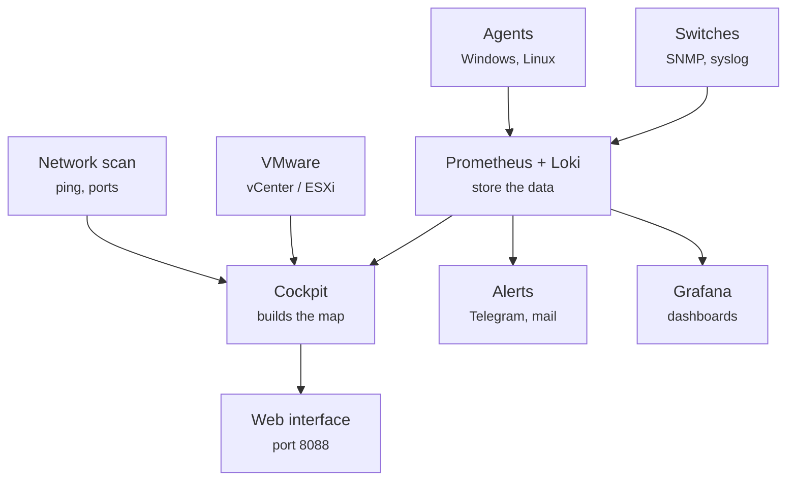
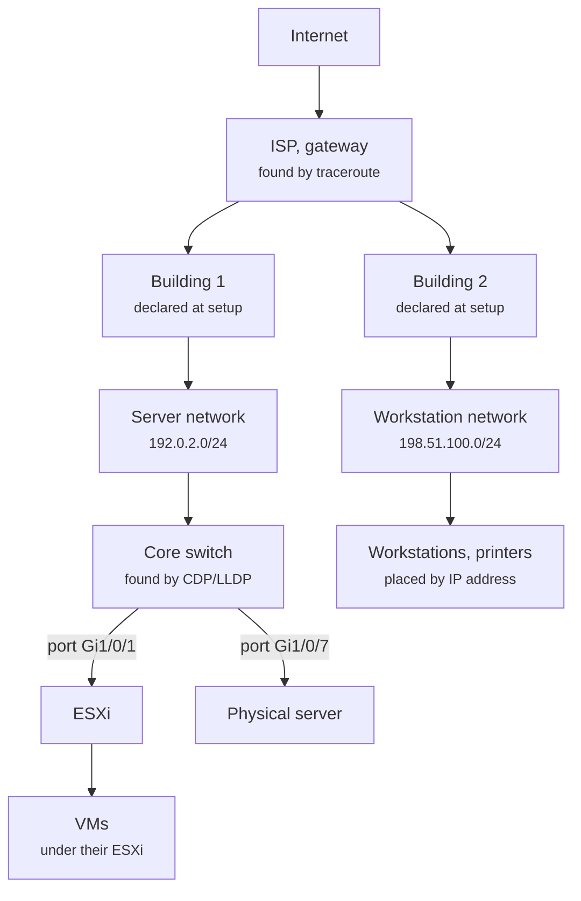

# How NetCockpit works

[Français](comment-ca-marche.md) · [Back to the documentation](README.md)

A plain-language explanation of what happens between the installation and the map on your screen. For the technical details, see [Topology](topology.md).

## The big picture

Four ideas are enough to understand everything:

1. **Data arrives in two ways.** The cockpit **fetches** some of it itself: it scans the network (who is on, and what is it) and queries VMware. The rest is **sent** to it: agents installed on Windows and Linux servers push their metrics and logs, and switches send their logs over syslog.
2. **Prometheus and Loki are the memory.** Prometheus keeps numbers over time (CPU, RAM, disk, traffic), Loki keeps the logs. NetCockpit does not reinvent these: it reuses well-known, reliable tools.
3. **The cockpit is the brain.** It is the part written for the project, in Python. It cross-checks every source (the IP found by the scan, the VM seen in VMware, the agent's metrics), makes one record per device, then places everything by building and network to draw the map.
4. **Three outputs.** The web interface to look, alerts on Telegram or by mail to be warned, and Grafana for detailed dashboards.

## How the map is built

The map is a family tree: every device has a "parent". The server is plugged into a switch, the switch is in a network, the network in a building, and so on up to the Internet.

To fill it, the cockpit always follows the same order, about every two minutes:

1. **Who is there? The scan.** It pings every address of the declared networks. For each device that answers, it looks at a few open ports, its DNS name, its Windows (NetBIOS) name and the brand of its network card. From these clues it guesses its role:
   - 53 + 88 + 389 open together (DNS, Kerberos, LDAP): a domain controller;
   - 902 + 443: an ESXi host;
   - 9100 without 22 or 3389: a printer;
   - 3389 (remote desktop): a Windows machine;
   - 22 alone: a Linux machine.
2. **Other sources complete the record.** VMware gives the ESXi hosts and their VMs (each VM goes under its host), agents give the real name, OS, RAM and CPU. One server seen by the scan, by VMware and by its agent becomes **one single** record: the cockpit matches them by IP address, MAC address or name.
3. **The path to the Internet.** A traceroute gives the gateway, then the ISP: the top of the tree.
4. **Buildings and networks** are not guessed: they are the ones declared at setup. A network that is seen but not declared shows up under "networks seen but not declared yet".
5. **Switches.** To know what is plugged into which port, the cockpit uses **CDP and LLDP**, the small messages devices send to their direct neighbours: "I am switch X, and you are on my port Gi1/0/1". It gets them:
   - **through the ESXi hosts**, which receive these messages: VMware passes them on, with no access to the switches at all. It works even when a provider manages the network;
   - **through Linux agents** (lldpd);
   - **through SNMP**, when you have read access: MAC address and neighbour tables.

   The switch with the most links becomes the "core", and the others hang under it by the right port.
6. **Everything else** goes under its network, by IP address: most workstations and printers.

## Colours, without false alarms

The tree does not change at every scan. On top of it, the cockpit colours every device:

| Colour | Meaning |
|---|---|
| Green | It answers (ping, port, agent or VMware) |
| Orange / red | It answers but has alerts |
| Red "down" | An **important** device (server, VM, ESXi, domain controller, switch, firewall) that answered and stopped |
| Grey "absent" | A **non-critical** device (PC, phone…) no longer answering: normal in the evening |

Only important devices can turn red and raise an alert. That is what keeps you from being woken up because a laptop went home.

---

NetCockpit is developed by [Enzo Marechal](https://enzomarechal.fr), with the help of AI tools, and used in production in a small company.
